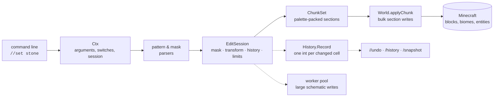

<div align="center">

# FAWE-BIM

**WorldEdit 7.4 + FastAsyncWorldEdit, as a single Fabric mod for Minecraft 26.2.**
No plugin loader. No Paper. No client mod for players. 255 of 255 upstream command names, zero stubs.

[](https://github.com/MaxLananas/FAWE-ButInMods/actions/workflows/build.yml)
[](LICENSE.txt)
[](https://www.minecraft.net/)
[](https://fabricmc.net/)
[](https://modrinth.com/mod/fabric-api)
[](https://adoptium.net/)

[](#verification)
[](#status)
[](#status)
[](#status)
[](#feature-matrix)
[](#continuous-integration)
[](#zero-artifact-ci)

[Install](#install) · [Feature matrix](#feature-matrix) · [The engine](#the-engine) · [Benchmarks](#benchmarks) ·
[Verification](#verification) · [Ecosystem](#the-ecosystem-it-lives-in) · [FAQ](#faq) ·
[Contributing](CONTRIBUTING.md) · [Discord](https://discord.gg/pnJhKuU2QK)

</div>

---

## What this is

FAWE-BIM is the WorldEdit + FastAsyncWorldEdit feature set, reimplemented as a **Fabric mod**. The
editing engine is written from scratch in platform-free Java (`core/`), and a thin Fabric adapter
(`fabric/`) teaches it about the game. That split is not cosmetic: the whole engine, its 2488
assertions included, runs in a plain JVM without ever launching Minecraft, which is how a 67k-line
port stays testable.

| | |
|---|---|
| **For players** | Every `//` and `/` command you already type, the brushes you already bind, the schematics you already saved. Wands, `/cui` outlines and hotbar selection sizes work on an unmodded client. |
| **For builders** | Multi-million-block `//set`, `//stack`, `//copy`, `//paste` with undo that costs megabytes instead of a heap of boxed objects. |
| **For server owners** | One jar, server-side editing, no plugin manager, no client install, block-change caps, timeouts, `//confirm` on large edits. |
| **For developers** | A platform-independent engine with a real benchmark harness, a 16-rule static auditor, a self-test suite, and an audit ledger of every defect found (see [BUGS.md](BUGS.md)). |

> [!NOTE]
> **Unofficial.** FAWE-BIM is independent work and is not affiliated with, endorsed by or supported
> by EngineHub (WorldEdit) or IntellectualSites (FastAsyncWorldEdit). Report problems
> [here](https://github.com/MaxLananas/FAWE-ButInMods/issues), never upstream.

---

## Table of contents

| | | |
|---|---|---|
| [Install](#install) | Requirements, setup, first command | [The engine](#the-engine) | How a `//set` actually reaches the world |
| [Quick tour](#quick-tour) | The twenty commands that teach the rest | [Benchmarks](#benchmarks) | Measured throughput and how to reproduce it |
| [Feature matrix](#feature-matrix) | Every group, with counts | [Verification](#verification) | Tests, audits, CI, and the defect ledger |
| [Status](#status) | The numbers, kept honest | [Ecosystem](#the-ecosystem-it-lives-in) | Sodium, Iris, shaders, Paper habits, plugin parity |
| [Configuration](#configuration) | `/fawebim` and the native screen | [Known limits](#known-platform-limits) | What a mod cannot do that a plugin can |
| [FAQ](#faq) | Servers, vanilla clients, modpacks | [Development](#development) | Build, test, audit, contribute |

---

## Install

| Component | Version | Side |
|---|---|---|
| Minecraft | **26.2** | client or server |
| [Fabric Loader](https://fabricmc.net/use/) | 0.20.1 or newer | required |
| [Fabric API](https://modrinth.com/mod/fabric-api) | 0.161.0+26.2 or newer | required |
| Java | 25 (the game's own runtime) | required |
| [Mod Menu](https://modrinth.com/mod/modmenu) | any 26.2 build | optional, client |

1. Install Fabric Loader for Minecraft 26.2.
2. Drop **Fabric API** and **FAWE-BIM** into `.minecraft/mods` (or your server's `mods/`).
3. Launch, then run `//wand` and click two corners.

Build it yourself with `./gradlew build`; the jar lands in `fabric/build/libs/`.

> [!WARNING]
> **Do not install WorldEdit or FAWE next to it.** All three register the same command names; the
> mod declares `"conflicts": { "worldedit": "*" }` and the game will tell you.

---

## Quick tour

Both spellings of every command work, because Minecraft strips exactly one slash from what you type —
`//set` reaches the command registered as `/set`.

```text
//wand                       give yourself the selection wand
//pos1  //pos2               set the corners (or left/right click with the wand)
//set stone                  fill the selection
//replace stone,dirt grass_block
//copy   //paste -a          clipboard, air skipped
//stack 10 up                repeat the selection ten times upward
//brush sphere stone 5       bind a radius-5 stone sphere brush to the held item
/tool mask #existing        brush settings: mask, material, range, size, tracemask, transform
//schem save builds/tower   schematics in ./schematics, subfolders included
//undo   //redo              history
/history find -u Steve -t 2h the edits of the last two hours
//regen 1234                 regenerate the selection with another seed
//generatebiome desert abs(x) < 20
/cui                        toggle the particle selection outline (vanilla clients)
/fawebim                    the settings screen
```

A selection can be previewed **without a client mod**: `/cui` asks the server to draw the shape with
particles twice a second, and the size of the selection appears above the hotbar as corners are
picked.

---

## Feature matrix

| Group | Count | What is in it |
|---|---:|---|
| Region | 46 | `//set`, `//replace`, `//walls`, `//faces`, `//hollow`, `//overlay`, `//smooth`, `//naturalize`, `//distr`, `//count`, `//size`, `//expand`, `//contract`, `//shift` |
| Generation | 24 | `//sphere`, `//cyl`, `//pyramid`, `//cone`, `//line`, `//curve`, `//spline`, `//image`, `//ores`, `//caves`, `//forestgen`, `//generatebiome`, `//feature`, `//structure` |
| Brush | 51 | sphere, cylinder, smooth, blendball, terrain (`height`, `cliff`, `flatten`, `heightmap`), erode, dilate, clipboard, copypaste, catenary, stencil, scatter, spline, recurse, gravity, butcher, … |
| Tool | 24 | `/tool` bindings, super-pickaxe modes, `farwand`, `lrbuild`, `deltree`, `tree`, `inspect`, mouse-wheel scroll actions |
| Clipboard | 14 | `//copy`, `//cut`, `//paste`, `//rotate`, `//flip`, `//stack`, `//move`, `//place`, lazy copy/cut |
| Selection | 19 | WorldEdit's seven shapes plus FAWE's polyhedral and fuzzy (magic wand); switching shape keeps the points |
| Anvil | 21 | `count`, `countall`, `distr`, `replace*`, `removelayers`, `trimallair`, `trimallplots`, `deletebiomechunks`, `deleteallunvisited`, … |
| Navigation | 8 | `/nav`, `/up`, `/ceil`, `/descend`, `/thru`, `/unstuck`, `/jumpto`, `/ascend` |
| Utility | 25 | `/we`, `/worldedit`, `/brush`, `/tool`, `/searchitem`, `/calculate`, `//registry`, `//cancel`, `//confirm` |
| History | 4 | `//undo`, `//redo`, `/history list\|find\|rollback\|restore` |
| Snapshot | 6 | `/snapshot list\|use\|before\|after\|sel\|restore` |
| Chunk | 4 | `//listchunks`, `//delchunks`, `//chunk`, `//regen` |
| Biome | 5 | `//setbiome`, `//biomelist`, `//biomeinfo` |
| Schematic | 2 | `//schem` with `list`, `save`, `load`, `loadall`, `move`, `delete`, `formats` |

Masks and patterns are FAWE's: `#existing`, `#surface`, `#region`, `#clipboard`, `%`, `!`, `##`, `|`,
`~`, `{`, `/`, `=expression`, angle and offset masks, `//gmask`, `//gsmask`, weighted lists, noise
patterns, gradients and color matching.

---

## The engine



A `//set` over a million blocks does not become a million calls into the world. It becomes a
million writes into per-chunk buffers, then one bulk write per chunk, then one flush of the side
effects (lighting, neighbour updates, block entities) on the server thread.

**The three ideas that do most of the work**

| Idea | What it buys |
|---|---|
| **Chunk buffering** | Writes land in a per-chunk buffer (`ChunkSet`) instead of the world; one flush per chunk, with lighting and neighbour updates deferred to the end. |
| **Packed sections** | A 16³ section is a palette, an open-addressed state index and a bit-packed `long[]`: 1 to 16 bits per cell instead of 16 KB of ints. A `written` bitset makes a flush walk set bits, not 4096 cells. |
| **Primitive history** | An undo row is **one `int`** — cell in the low 12 bits, state above it — so a filled section costs 16 KB and a million-block undo about 4 MB. |

**What profiling changed** (all of it measured, none of it guessed)

| Bottleneck the profile found | Fix | Before → after |
|---|---|---|
| Palette walked entry by entry on every write | last-write cache + open-addressed index | 487 ns → 3.7 ns per block |
| Masks held states in a `Set<Integer>` | primitive `IntSet` with a rejected-state cache | 13 ns → 3.0 ns per question |
| Chunk buffer asked a hash set "is this cell written?" | one bit per cell, flush walks the set bits | 8.4M-block buffer: 75.6 → 54.3 ms |
| Shapes tested every cell of their bounding box | per-layer discs walked as **spans of x** | `//hsphere` 2.0 → 0.9 ms |
| `//walls` alternated planes, so every block changed chunk | one plane at a time | 1.1 → 0.52 ms around 64³ |
| `//paste` built a position object per cell | walk the clipboard, take the state as you go | now the same rate as `//set` |
| Expressions resolved names and operators per block | resolve once, evaluate on a stack | `sin(x/10)+cos(z/10) > y/20`: 260 → 112 ns |
| Edit timeout read the clock per block | clock every 512 blocks | one `nanoTime` call per 512 writes |

The compile cost of that is bounded too: **71 – 73 s** from a checked-out tree to a tested, verified
jar in CI, on one Gradle invocation with a warm module cache (see
[Continuous integration](#continuous-integration)).

---

## Benchmarks

`./gradlew :core:bench` prints that table on your machine: an in-JVM `256×256×128` world,
single-threaded, best of seven runs after warm-up. The ranges come from several runs of the same
binary, because the spread between two runs is wider than the effect of most changes — a single
number would be a claim the harness cannot support.

| Operation | Rate |
|---|---|
| Block writes, engine with history | **34 – 38 M blocks/s** |
| Block writes, engine without history | **63 – 66 M blocks/s** |
| `//set` over 64×64×64 | **41 – 43 M blocks/s** |
| `//copy` over 64×64×64 | **68 – 72 M blocks/s** |
| `//paste` over 64×64×64 | **31 – 33 M blocks/s** |
| `//replace` over 64×64×64 | **30 – 33 M blocks/s** |
| `//sphere` radius 40 | **32 – 43 M blocks/s** |
| `//undo` and `//redo` of that `//set` | **78 – 92 M blocks/s** |
| A mask asked about a block | **262 – 294 M questions/s** |

In a live game, vanilla lighting recalculation and chunk packets to nearby players add on top of
raw buffer write time. Every row prepares the world with the state the edit is about to overwrite,
because an edit that finds the value already there returns early — a benchmark of that measures
nothing.

---

## Verification

Nothing in this repository is on the honour system: each number below comes from something that
fails when it stops being true.

| Check | Command | What it proves |
|---|---|---|
| Engine self-test | `./gradlew :core:selfTest` | **2488 assertions, 0 failing**, no Minecraft needed: regions, masks, patterns, transforms, clipboard formats, history, brushes, commands |
| Dispatcher verify | `./gradlew :core:verify` | all **457 command spellings** — the 255 upstream names, their 201 aliases and the FAWE-only ones — resolve to an implemented command |
| Command registry dump | `./gradlew :core:commandSpec` | the live registry, which the tables are generated from |
| Static audit | `python3 tools/audit.py` | **16 rules** over every source file: dead private members, empty catches, boxed `==`, int overflow, unguarded parses, shared static maps, resource leaks, `Math.random`, locale-dependent casing, swallowed failures |
| Live server test | CI only | boots a dedicated server with the mod, drives it over rcon and checks that `//pos1`, `//pos2`, `//set stone` (4096 blocks) and `//count stone` (4096) really changed the world |

**The defect ledger.** The audits are not decorative: every finding is triaged into
[`BUGS.md`](BUGS.md), a numbered list of real defects with cause, fix and file. It is at **65 of 80**
documented defects today — world-apply bugs, lighting and biome indexing, save/load correctness,
NBT and varint parsing, history retention, CI cost, and hot-path allocation. The list is public and
incomplete on purpose: the honest count is more useful than a green checkmark.

<details>
<summary><b>A few entries from the ledger</b></summary>

- `//regen` asked a chunk for blocks above the build height; the answer is air now.
- `//undo` of a paste restored an **empty** block entity instead of the chest it found.
- A schematic saved as MCEdit could allocate two arrays of 2 GB with no budget check.
- History files were written to disk and **never deleted**, so a busy server filled its disk with
  history it could no longer read.
- `Snapshots.list` sorted file names as text, so the sixteenth snapshot of a millisecond was listed
  as older than the fifteenth.
- The NBT varint reader accepted a sixth byte and silently dropped its bits.

</details>

### Continuous integration


There is **one job**, one checkout, one JDK and one Gradle invocation — plus a second tiny job that
deletes any artifact the repository still holds. Measured on a recent run:

| Step | Time |
|---|---|
| Compile + self-tests + jar (`build` **and** `:core:verify`, one JVM) | **71 – 73 s** |
| Dedicated server up | 17 s |
| Cache save at end of job | 3 s |
| **Whole run** | **1 min 44 s** |

### Zero-artifact CI

GitHub Actions storage is a resource, and build outputs are not worth it: the `purge-artifacts` job
keeps the repository at **0 artifacts**, and the workflow uploads none. What a CI run has to prove —
that the mod compiles, that the engine tests pass, that the mixin applies, that commands register
and that a `//set` really writes blocks — is proven inside the run, not stored afterwards.

---

## Status

| | |
|---|---|
| Engine tests | **2488 passing, 0 failing** |
| Commands registered | **300** |
| Implemented | **253** (+ 47 aliases of an implemented command) |
| WorldEdit + FAWE command names that resolve | **255 / 255** |
| Brushes with their upstream signature | **46** |
| Command switches upstream declares but this build lacks | **0** |
| Flags declared but never read | **0** |
| Settings in `config/fawebim.yml` | **43, every one read by the code** |
| Registered but still to port | **0** |
| Commands a console, command block or function can run | **146** (the other 107 need a player) |
| Source | **67k lines of Java** — 208 files, `core/` free of Minecraft types |

---

## The ecosystem it lives in

FAWE-BIM is deliberately boring to everything else in your mods folder. It touches **no rendering**,
ships **one mixin** (the server packet listener: mining swings, brush swings, wheel scrolls) and asks
the game to open **ten entries** with an access widener — two nested classes and eight members, each
one commented in the file with the reason it is there.

| Hooking into the game | What and why |
|---|---|
| **1 mixin** | `ServerGamePacketListenerImpl` — arm swings and hotbar-slot changes: a brush fires once per swing and never while you are mining, and the mouse wheel drives `scroll` actions. The injections sit before the game's own thread check, so only the server-thread call acts |
| **8 widened members** | the "is mining" flag, the command source behind a command, the server main-thread executor, `LevelChunk#updateBlockEntityTicker`, the light engine's `addTask`/`blockEngine`/`skyEngine`, and `ChunkHolder#addSaveDependency` |
| **2 widened classes** | `ServerChunkCache$MainThreadExecutor` and `ThreadedLevelLightEngine$TaskType` — both private since 26.1 |

<details>
<summary><b>Client-side performance and visual mods</b></summary>

Editing is server-side, and the mod's only visible output is ordinary block updates plus vanilla
particles. Nothing to patch, nothing to configure:

| Mod | Interaction |
|---|---|
| **Sodium**, **Sodium Extra**, **Reese's Sodium Options** | none — rendering only. Big builds still pay for the geometry Sodium has to rebuild, which is where its own speed helps. |
| **Iris Shaders**, plus **Complementary Reimagined / Unbound**, **BSL**, **Photon**, **Solas**, **Bliss**, **Rethinking Voxels**, **MakeUp Ultra Fast**, **Sildur's Vibrant**, **Kappa**, **Nostalgia**, **AstraLex**, **SEUS** | none — the mod draws no geometry. `/cui` outlines are particles, so they are lit and fogged by the pack exactly like every other particle. |
| **Lithium**, **FerriteCore**, **ImmediatelyFast**, **Krypton** | none — the mod neither caches nor ticks anything they optimise; on a server, Lithium's chunk work and FAWE-BIM's bulk writes are complementary. |
| **Distant Horizons** | none — DH reads the world, and the world only contains the blocks the server wrote. |
| **Mod Menu** | optional: adds a *Configure* button that opens `/fawebim`'s native screen. |
| **JEI / REI**, **Xaero's Minimap / World Map**, **Jade**, **AppleSkin** | none. |
| **Litematica**, **Axiom**, **Effortless Building**, **Create**, **Chisels & Bits** | none — they edit through the same game APIs; the one real conflict is a mod that also claims the `//` namespace. |

</details>

<details>
<summary><b>Coming from Paper, Spigot or a plugin server</b></summary>

| You have | FAWE-BIM equivalent | What changes |
|---|---|---|
| **WorldEdit** plugin (6.4M downloads, the reference) | the whole command surface, same names, same arguments | no Bukkit: it runs on Fabric, in singleplayer too |
| **FastAsyncWorldEdit** plugin (async, millions of blocks) | the same buffered engine idea: palette-packed sections, bulk chunk writes, deferred lighting | no async region rewriting behind the server's back |
| **WorldGuard** | *not ported* | regions/claims are a separate job; `/anvil deleteunclaimed` reports that no claim provider exists instead of pretending |
| **LuckPerms** | *not ported* | one permission: "may use the mod" (op level 2, console, or singleplayer owner), exposed through the game's own permission set |
| **EssentialsX**, **Vault**, **CoreProtect** | out of scope | chat, economy and logging are not what an editing mod should do; `/history` covers *this mod's* edits |
| `/cui` + WorldEditCUI client mod | `/cui` answered by the server | exact shapes, drawn as particles, no client installation |

</details>

---

## Configuration

All 43 settings live in `config/fawebim.yml` and are editable **in game**, no restart:

```text
/fawebim                           open the settings screen (chat listing without a client)
/fawebim settings                  list every setting with its current value
/fawebim settings wand             only the settings whose name matches
/fawebim set max-brush-radius 50   change one and write the file
/fawebim reset max-brush-radius    back to the shipped value
/fawebim reload                    pick up a file edited by hand
```

The screen is a normal `Screen` of the game: groups on the left, one row per setting with the editor
for its type, search, per-row Reset, and a description line. Tab completion in chat covers the
actions, the keys and the accepted values.

Safety knobs that matter: `limits.max-blocks-changed`, `limits.max-radius`, `limits.max-schematic-size`,
`limits.max-brush-range`, the operation timeout behind `//timeout`, and `//confirm` for large edits.

> [!NOTE]
> A setting that nothing reads cannot ship: the audit compares the declaration table with every use
> in the code, and settings that only make sense for a server queue are not offered at all rather
> than shown as knobs that pretend to work.

---

## Known platform limits

A few upstream features need something a standalone Fabric mod does not have. Where that is the
case, the command says so instead of failing silently.

> [!IMPORTANT]
> **CraftScripts** (`//cs`, `//.s`) run through a JSR-223 engine, and modern JVMs ship none. The
> command reports that clearly rather than pretending the script ran.

> [!NOTE]
> **`/anvil`** reads region files (read-only) to decide which chunks qualify, then edits those chunks
> through the running server. Rewriting `.mca` files behind a live server is what made FAWE's own
> anvil commands unsafe, and is deliberately not done.

> [!NOTE]
> **Claim checks** in `/anvil deleteunclaimed` and `/anvil trimallplots` need a claim provider. A mod
> has none to ask, so the chunk-age test decides and the report says the check was skipped.

> [!NOTE]
> **`/cui`** is answered by the mod: WorldEdit's handshake expects a client mod a vanilla client does
> not run, so the server draws the selection itself. Exact for every shape, but dotted particles
> redrawn twice a second, not client-rendered wireframe lines.

---

## FAQ

<details>
<summary><b>Do players on my server need to install it?</b></summary>

No. FAWE-BIM + Fabric API on the server is enough: vanilla 26.2 clients can join, use wands, see
selection sizes and watch `/cui` outlines. The client install is only needed for singleplayer or for
the graphical settings screen.
</details>

<details>
<summary><b>How fast is it, really?</b></summary>

The buffer path runs at 30–90 M blocks/s depending on the operation, measured by `:core:bench` (see
[Benchmarks](#benchmarks)). What limits a live edit is the game, not the buffer: lighting, chunk
saves and packets to nearby players. That is why side effects are deferred to the end of the edit
instead of run per block.
</details>

<details>
<summary><b>Can I load my existing WorldEdit and FAWE schematics?</b></summary>

Yes: Sponge `.schem` **v1, v2 and v3**, legacy MCEdit `.schematic`, and vanilla structure `.nbt` —
subfolders included. Blocks this game does not know are reported and loaded as air rather than
silently dropped; a `.schematic` whose numeric ids are disabled by
`allow-ancient-blocks` warns instead of loading an empty build. Saving writes Sponge v3 by default.
</details>

<details>
<summary><b>Why a mod and not a plugin?</b></summary>

Because singleplayer exists. A plugin needs a Bukkit/Paper server; a mod runs everywhere Fabric runs,
which includes the world a player opens at home with cheats off — where the singleplayer owner still
gets every command. The engine is platform-free, so a plugin front end would be a thin adapter, not
a rewrite.
</details>

<details>
<summary><b>Can I put it in a modpack?</b></summary>

Yes. FAWE-BIM is GPL-3.0 free software; ship it in Modrinth or third-party packs, as long as
WorldEdit/FAWE are not in the same pack. The jar is self-contained (the engine is nested), needs only
Fabric API, and adds no world content.
</details>

<details>
<summary><b>Is it safe on a production server?</b></summary>

The editing path is capped (`max-blocks-changed`, radius, schematic size, brush range), timed
(`//timeout`, `//cancel`), confirmable (`//confirm`) and reversible (`//undo`, `/history rollback`,
`/snapshot`). `/anvil` never writes region files behind the server. What it does *not* have is a
claim system: do not give it to players you would not give WorldEdit to.
</details>

---

## Development

Prerequisites: **JDK 25**. Gradle, Loom, Minecraft and Fabric API are fetched by the wrapper (Gradle
9.8.2, `net.fabricmc.fabric-loom` — since 26.1 the game is unobfuscated, so there are no mappings and
no `modImplementation`).

```bash
./gradlew :core:selfTest      # engine suite, no Minecraft required
./gradlew :core:verify        # self-tests + every upstream command name through the dispatcher
./gradlew :core:bench         # throughput harness
./gradlew :core:commandSpec   # dump the live command registry
./gradlew build               # core + Fabric mod
./gradlew :fabric:runServer   # dedicated test server
./gradlew :fabric:runClient   # test client
python3 tools/audit.py        # static audit, 16 rules
python3 tools/audit.py --rule empty-catch   # one rule at a time
```

### Project layout

```text
core/      platform-free engine — regions, masks, patterns, transforms, EditSession and its chunk
           queue, history, clipboards and every schematic format, brushes, tools, expressions, and
           the registry holding the whole WorldEdit + FAWE command surface.
fabric/    the adapter — mod entry point, Brigadier registration, world access (bulk section writes,
           lighting, entities, block entities), the block-state and biome bridge, click and
           interaction callbacks, one mixin and one access widener.
tools/     the static auditor and the checks run over the tree.
BUGS.md    the defect ledger: every real bug found, with cause, fix and file.
```

Where to start reading: `core/.../extent/EditSession.java` (the pipeline), `core/.../world/ChunkSet.java`
(the buffer), `fabric/.../FabricWorld.java` (how a buffer becomes blocks, light and packets).

See [CONTRIBUTING.md](CONTRIBUTING.md) for the porting workflow and code style, and
[CODE_OF_CONDUCT.md](CODE_OF_CONDUCT.md) for community expectations.

---

## Credits and licence

Licensed **GPL-3.0** ([`LICENSE.txt`](LICENSE.txt), the WorldEdit licence). This is an independent
implementation whose *behaviour* is derived from two GPL-3.0 projects, and it would not exist
without them:

- **[WorldEdit](https://github.com/EngineHub/WorldEdit)** by sk89q, EngineHub and contributors — the
  command set, syntax and editing model everything here follows.
- **[FastAsyncWorldEdit](https://github.com/IntellectualSites/FastAsyncWorldEdit)** by
  IntellectualSites — the buffered engine idea, the brush suite, and the parts of the command surface
  FAWE adds on top.

Command names, aliases, switches, argument order, parsers and messages follow those projects; see
[`NOTICE`](NOTICE) for the full attribution.

Thanks to the wider ecosystem whose work shaped this one: **Sodium**, **Iris**, **Lithium**,
**FerriteCore**, **Mod Menu** and the shader packs listed above, for making a modded 26.2 client
worth building for; and to the server-side classics — **EssentialsX**, **LuckPerms**, **CoreProtect**,
**Vault** — for showing what a server actually needs from an editing tool.

<sub>Project icon artwork by <a href="https://www.instagram.com/elfi_draw">Elfi (@elfi_draw)</a>.
assets ship with the repository.</sub>

<div align="center"><sub><b>FAWE-BIM</b> · unofficial · <a href="https://github.com/MaxLananas/FAWE-ButInMods/issues">issues</a> · <a href="https://discord.gg/pnJhKuU2QK">discord</a> · <a href="BUGS.md">defect ledger</a></sub></div>
